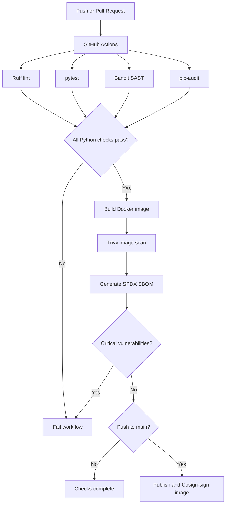

# Architecture

## Runtime

- FastAPI provides the REST endpoints.
- SQLite stores tasks in a persistent local database.
- Docker runs the application as a non-root user.
- Docker Compose adds a persistent volume and drops Linux capabilities where supported.

## CI security boundary

Pull requests can run tests and build/scan the image, but only pushes to `main` publish the already-scanned image to GHCR. The container job uses the short-lived `GITHUB_TOKEN` and requests package-write permission only for its publishing steps.
